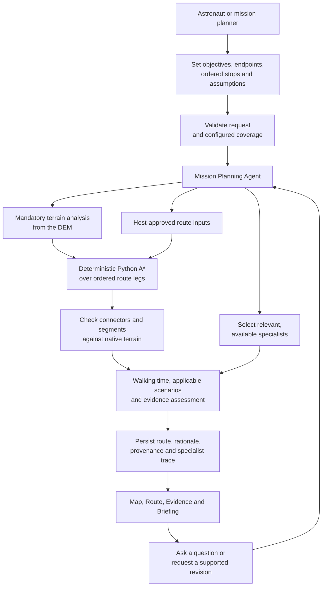

# A-STELLAR

**Agent-assisted traverse planning for Mars mission preparation.**

[Demo](#link-to-project-demo) · [Project](#link-to-final-project) ·
[Features](#mission-workspace) · [Workflow](#planning-workflow) ·
[NASA data](#nasa-data) · [Get started](#get-started) ·
[Documentation](docs/README.md)

## Project Name

**A-STELLAR**

- **Team:** Pending; add the public team name and member names before submission.
- **Challenge:** Pending; add the official English challenge title and link.

## High-Level Project Summary

A-STELLAR is a web workspace that brings Mars imagery, terrain-based route
planning, scientific context and a conversational planning agent together.
Our Jezero Crater demonstration lets a mission team choose destinations, plan
an ordered traverse, inspect the evidence behind it and revise the itinerary
through conversation.

Planning a future astronaut traverse means connecting science objectives with
terrain constraints, travel time and incomplete environmental evidence.
A-STELLAR addresses that planning problem by combining NASA resources with
specialists for terrain, thermal context, radiation scenarios, geology and rover
history. The Mission Planning Agent coordinates available analyses and explains
the result; a deterministic Python host computes and checks the A* route.

This demo helps astronauts and ground planners explore a proposed journey,
understand its supporting evidence and refine a mission plan in one workspace.

<!-- Screenshot: Mission workspace with a Jezero route, selected stops and mission summary. -->

## Link to Project Demo

[Watch the A-STELLAR project demo on YouTube](https://www.youtube.com/watch?v=DzHkKI60o0Y).

Use either a **video of 30 seconds or less** or a **slide deck of up to seven
slides, including the title and introduction**. The link must open without a
password, access request or registration. Use English slides, or English
subtitles if the video is spoken in another language.

**SI audio disclosure:** The demo narration was generated with ElevenLabs.
Include the credit **“Narration generated with ElevenLabs (AI).”** in the
published demo description or credits and in the audio/video metadata.

## Link to Final Project

The final project source and run instructions are available in the
[A-STELLAR GitHub repository](https://github.com/bulin11636/A-STELLAR-NASA-Hachathon).
This repository is the project link; a hosted application URL can be added here
if the team publishes one. Reviewers can follow [Get started](#get-started) to
run the application with the required external inputs.

## Detailed Project Description

### Supporting astronauts on Mars

A future surface mission must connect multiple objectives: reach a science
location, visit sites in a required order, account for walking time, and
understand which environmental conditions remain uncertain. These decisions
involve evidence from different instruments, coordinate systems and time periods.

A-STELLAR explores how a shared workspace could help astronauts and ground
planners:

- Prepare a traverse around terrain constraints and explicit mission priorities.
- Inspect geological targets and historical rover observations alongside the route.
- Estimate travel and stop time from stated walking assumptions.
- Ask why a route was proposed, add a location, or change the visit order.
- See missing evidence, assessment limitations and source provenance before
  treating a result as decision support.
- Export a briefing and retain the relationship between earlier and revised routes.

The demo demonstrates this workflow with Jezero data, focusing on terrain,
walking-time assumptions, scientific context and conversational route revision.

### Mission workspace

#### Plan a traverse

Choose start and goal coordinates, add up to **16 ordered intermediate visits**,
and select a terrain objective or mission profile. Advanced controls expose
walking speed, stop duration, required analyses and bounded planning resolution.
Backend-provided examples make it possible to start with supported DEM locations.

The planner supports regional requests across the configured DEM source, rather
than restricting every route to the small initial example window. Actual routes
remain subject to data coverage, traversability and search limits.

<!-- Screenshot: Plan tab with ordered waypoints and Advanced mission settings. -->

#### Explore Mars and its evidence

Use NASA Mars Trek's **Viking global imagery** and the higher-resolution
**Jezero HiRISE / CTX / HRSC mosaic** for visual context. Available local layers
can include DEM coverage and previews, THEMIS day/night previews, geology,
science points, rover traverses and rover stops. Visibility and opacity controls
let a user inspect these sources independently.

Available spatial layers appear in the map controls. Numerical radiation
scenarios appear in the assessment and briefing. Source resolution is recorded
alongside the imagery and terrain inputs.

Computed routes are displayed on NASA imagery using the implemented coordinate
conversion. Route metadata records the coordinate and pixel-registration status.

<!-- Screenshot: Evidence tab with independently controlled map layers. -->

#### Understand the route

The Route view presents distance, walking-time assumptions, ordered legs,
actual grid resolution, planning limits and specialist evidence. Profiles include
Safest, Fastest, Science priority and Balanced for different mission priorities.

Risk is shown with assessment confidence and evidence coverage. An available-factor
partial score excludes missing factors rather than assigning them zero risk.
Evidence coverage represents the share of profile weight supported by assessed factors.
Blocked or unassessed mission requirements remain visible.

<!-- Screenshot: Route tab showing legs, partial assessment, confidence and limitations. -->

#### Discuss and revise the plan

The **Mission Planner** tab supports questions about the stored route and bounded
requests to add explicit locations or change their visit order. Informational
answers leave the route unchanged. Accepted revisions are computed again by the
host, checked, stored, and linked to their parent route.

Agentic mode uses a configured model provider. Deterministic mode keeps terrain
planning available without live model calls and offers a narrower explanation
workflow. Request status and explicit recovery controls help retrieve completed
work without automatically repeating a paid generation request.

<!-- Screenshot: Mission Planner conversation explaining a route or revising its stops. -->

#### Share a mission briefing

The Briefing view organizes **known conditions**, **attention areas** and
**limitations**, with technical details available separately. JSON export
preserves the route, assessment, source context and unknown values for review.

<!-- Screenshot: Mission Briefing with known conditions, attention areas and limitations. -->

### Planning workflow



Scientific context is not automatically a spatial routing cost. The backend
controls which evidence can affect a calculation, enforces required analyses,
and keeps unavailable or incompatible evidence explicit.

### Specialist agents

| Specialist | Contribution | Inputs and implementation |
| --- | --- | --- |
| Mission Orchestration and Route Planning Coordinator | Interprets intent, selects tools and explains host-generated routes | Structured proposals validated and executed by the host |
| Surface Traversability and Terrain Hazard Agent | DEM coverage, slope-based terrain policy and native-segment checks | DEM-derived elevation, slope and terrain policies |
| Thermal Environment and Exposure Context Agent | Available thermal-context inputs and qualitative raster evidence | Qualitative context from available thermal visual mosaics |
| Radiation Exposure and Mission Dose Assessment Agent | Explicit duration-based exposure scenarios when configured | Historical dose scenarios with explicit duration assumptions |
| Geological Context and Science Opportunity Agent | Regional geology and source-backed science locations | Source-backed geological units and science locations |
| Surface Obstacle Context | Integrated into the terrain specialist | Part of the terrain-processing workflow |
| Rover Traverse and Observation Evidence Agent | Historical rover locations, traverses and observation references | Historical traverses, locations and observation references |

Each specialist retains its own evidence scope and limitations. Configuration,
selection, execution and evidence quality are reported separately. See the
[agent guide](docs/agents.md) for the implementation contracts.

### Extensibility

The architecture separates **data processing**, **specialist interpretation**,
**route computation** and **map presentation**. A new layer or analysis can be
added without rewriting the route planner:

1. Bind a documented source with its units, coordinate system, coverage and provenance.
2. Implement a typed specialist result and register the authored worker explicitly.
3. Define how its output contributes: visual context, a mission-level scenario,
   or a separately validated routing constraint.
4. Add a map layer only when a spatial artifact and display extent are available.
5. Verify unavailable, incompatible and successful cases before enabling it.

**Other Mars locations.** The layer-and-specialist approach can be adapted to
other craters, landing sites and exploration areas by supplying regional DEMs,
imagery and scientific evidence. Each region would have its own source coverage,
coordinate transforms, map registration and mission assumptions. The current API
is configured for Jezero; supporting additional regions requires extending its
region configuration and contracts as well as validating the new inputs.

**Live data and dynamic route allocation.** Future layers could consume
time-stamped measurements from surface sensors, rovers or astronaut equipment,
such as thermal conditions, radiation readings, newly observed obstacles and
crew positions. Specialists could interpret incoming evidence, and validated
changes to routing costs or constraints could trigger host-computed A*
replanning. The workspace could then display updated routes, assignments and
reasons for each change. This would support real-time route assignment and
replanning, subject to data freshness, communications and processing latency.
Implementing it requires live-feed adapters, freshness checks, update triggers
and versioned route results; the current demonstration uses configured datasets
and request-driven planning.

Other potential extensions include communications coverage, illumination windows,
energy and consumables, and additional sensors. These capabilities are future
extension directions. The [architecture guide](docs/architecture.md) explains
the current boundaries.

### Tools and development environment

| Area | Technologies and role |
| --- | --- |
| Interactive workspace | React, TypeScript, OpenLayers and Vite for the map, planning forms, evidence views and conversation |
| Backend and contracts | Python, FastAPI, Pydantic and Uvicorn for validated APIs, request handling and stored route results |
| Terrain and geospatial processing | NumPy, Rasterio and PyProj for DEM processing, coordinate conversion and deterministic A*; Fiona and Shapely for optional geology support |
| Model coordination | OpenAI model API through HTTPX for structured intent, tool selection and explanations; terrain planning also runs in deterministic mode |
| Verification | pytest, TypeScript tests and Playwright for backend, frontend and browser workflows |
| Packaging and collaboration | Docker, Docker Compose, Git and GitHub; development environments include Windows and Linux through WSL on x86-64 PCs |

No dedicated flight hardware or custom scientific instrument is part of this
demo. The production web workflow does not require LangGraph; the repository
also contains an optional LangGraph experiment. Dependency declarations are in
[the frontend package manifest](frontend/package.json) and
[the backend project manifest](backend/pyproject.toml).

## Use of Super Intelligence (SI)

**The team originated the core concept and system architecture.** SI tools
assisted implementation, exploration and presentation as described below.

| Tool or artifact | Where and how SI was used |
| --- | --- |
| OpenAI Codex | Assisted application implementation, debugging, test development, refactoring and documentation, including this README |
| Google Gemini | Assisted early standalone test-program development and dataset exploration |
| OpenAI model API in the application | Interprets planning requests, selects allowed specialist tools, proposes structured revisions and explains stored results in agentic mode |
| ElevenLabs | Generated the narration for the project demo; the published media must acknowledge SI audio in its descriptive text and metadata |

Host code validates model proposals and computes route geometry with A*.
Derived distances, walking times and scenario calculations come from numerical
code and stated inputs. Scientific source measurements retain their provenance,
and small synthetic test fixtures are identified separately from NASA observations.

The [SI disclosure metadata](docs/si-disclosure.json) records the confirmed
project-level use of these tools, including code/documentation assistance and
the narration credit. Runtime route records separately retain model usage where
applicable, model commentary, specialist traces and source context.

For publication, copy the ElevenLabs credit into the actual media metadata as
well as its description. Any SI-generated images or video added later must
carry a visible SI-generation watermark. SI-generated content must not use,
contain or modify NASA logos, flags, mission identifiers or other NASA branding
elements. Follow the [NASA brand guidelines](https://www.nasa.gov/nasa-brand-center/brand-guidelines/)
and retain attribution for the original scientific imagery.

## NASA Data

NASA resources make the Mars map, terrain interpretation and historical mission
context possible. The table describes the core demonstration and optional
inputs, whose availability depends on each installation's configured datasets.

| NASA resource or instrument data | Specific product and use | Scope in this project |
| --- | --- | --- |
| [NASA Mars Trek](https://trek.nasa.gov/) | Viking global visible-light color mosaic, layer `Mars_Viking_MDIM21_ClrMosaic_global_232m`, for global map context | Online basemap; approximately 232 m/pixel source detail |
| [NASA Mars Trek tile service](https://trek.nasa.gov/tiles/apidoc/trekAPI.html?body=mars) | Jezero HiRISE / CTX / HRSC mosaic, layer `NES_JEZ_MID_Visible_Mosaic_HiRISE_CTX_HRSC_GCS_MARS_07-10-2018`, for regional visual context | Online mosaic; combines NASA and ESA instrument imagery and is separate from the planning DEM |
| [Mars Reconnaissance Orbiter CTX data, processed by USGS](https://astrogeology.usgs.gov/search/map/mars_2020_science_investigation_ctx_dem_mosaic) | Mars 2020 Science Investigation CTX DEM Mosaic, `M20_JezeroCrater_CTXDEM_20m.tif`, for terrain, slope policy and native route checks | Required local terrain input; 20 m native grid |
| [Mars Odyssey THEMIS imagery, distributed by USGS](https://astrogeology.usgs.gov/search/map/mars_odyssey_themis_ir_day_global_mosaic_100m_v12) | Daytime infrared global mosaic; separately sourced nighttime input where available | Optional qualitative thermal context from visual infrared mosaics |
| [NASA Mars 2020 map resources](https://mars.nasa.gov/maps/location/api/configure/get?mission=M20) and [sample-site export](https://mars.nasa.gov/mmgis-maps/M20/Layers/json/M20_SAMPLE_v3.json) | Perseverance science locations, rover stops and traverse evidence | Selected historical browser records and optional verified snapshots |
| [PDS Mars 2020 Rover Places](https://pds-geosciences.wustl.edu/m2020/urn-nasa-pds-mars2020_rover_places/) and [Navcam archive](https://pds-imaging.jpl.nasa.gov/beta/archive-explorer?mission=mars_2020&bundle=mars2020_navcam_ops_raw) | Localization context, observation labels and image references | Source-backed evidence adapters; availability depends on the configured evidence profile |

The [dataset guide](docs/datasets.md) and
[acquisition manifest](data/samples/download-manifest.json) document exact source
links, download status, units, coordinate assumptions and provenance. They also
identify unresolved product URLs and excluded inputs. NASA imagery and local
terrain have different coverage and resolution; independent map registration
remains a validation task.

## Space Agency Partner Data and Other References

The Mars Trek Jezero mosaic includes
[HRSC imagery from ESA's Mars Express](https://www.dlr.de/en/research-and-transfer/projects-and-missions/mars-express/hrsc-high-resolution-stereo-camera)
alongside NASA HiRISE/CTX imagery. This is partner-instrument content within the
combined NASA-hosted product, not a separately ingested ESA dataset. No other
separate Space Agency Partner dataset is claimed here.

| Resource | Role and attribution |
| --- | --- |
| [USGS Astrogeology](https://astrogeology.usgs.gov/) | Producer/distributor of the CTX terrain mosaic and THEMIS visual products; USGS is credited separately from the source missions |
| [USGS Scientific Investigations Map 3464](https://doi.org/10.3133/sim3464) | Optional regional geology and science context; its scale and documented offsets limit fine alignment |
| [Reitz et al., ICES-2016-437](https://elib.dlr.de/106090/1/ME-SBA-2016-Reitz_MSL-RAD_ICES_2016.pdf) | Published MSL/RAD surface dose-equivalent measurements used for an explicit historical sensitivity scenario |
| [React](https://react.dev/), [TypeScript](https://www.typescriptlang.org/), [OpenLayers](https://openlayers.org/) and [Vite](https://vite.dev/) | Frontend libraries and build tools |
| [Python](https://www.python.org/), [FastAPI](https://fastapi.tiangolo.com/), [Pydantic](https://docs.pydantic.dev/), [Uvicorn](https://www.uvicorn.org/) and [HTTPX](https://www.python-httpx.org/) | Backend language, APIs, validation, server and provider HTTP client |
| [NumPy](https://numpy.org/), [Rasterio](https://rasterio.readthedocs.io/), [PyProj](https://pyproj4.github.io/pyproj/), [Fiona](https://fiona.readthedocs.io/) and [Shapely](https://shapely.readthedocs.io/) | Numerical and geospatial processing, including optional geology support |
| [pytest](https://docs.pytest.org/), [Playwright](https://playwright.dev/) and [tsx](https://tsx.is/) | Automated backend, frontend and browser verification |
| [Docker](https://www.docker.com/), [Git](https://git-scm.com/) and [GitHub](https://github.com/) | Packaging, version control and source hosting |
| [OpenAI Codex](https://openai.com/codex/), [Google Gemini](https://gemini.google.com/) and [ElevenLabs](https://elevenlabs.io/) | SI-assisted development, dataset exploration and demo narration, as disclosed above |
| [OpenAI API](https://platform.openai.com/docs/) and [LangGraph](https://docs.langchain.com/oss/python/langgraph/overview) | Application model integration and a separate optional graph experiment |

Dependency versions and transitive frontend packages are recorded in
[package.json](frontend/package.json), [package-lock.json](frontend/package-lock.json)
and [pyproject.toml](backend/pyproject.toml). Keep upstream licenses and notices
with redistributed dependencies. Additional screenshots, media, templates or
other external assets added for submission must also receive source and permission
credits here, following the applicable source terms.

NASA, JPL-Caltech, USGS, ESA and PDS credits belong to their respective products.
Use follows the [NASA media guidance](https://www.nasa.gov/nasa-brand-center/images-and-media/),
[JPL image policy](https://www.jpl.nasa.gov/jpl-image-use-policy/) and individual
source terms. For the official evaluation framework, consult the
[Space Apps Judging and Awards Guide](https://www.spaceappschallenge.org/resources/judging-awards-guide/).

## Get started

The Docker image serves the production frontend and API together. You need
Docker with Compose v2, Python 3.10+ for the launcher, the configured Jezero DEM,
and a private runtime file. See [datasets](docs/datasets.md) for acquisition and
[Docker setup](docs/docker.md) for Windows, WSL and persistent state.

From the repository root, copy `.env.example` to a private `.env`, configure it,
and run:

```bash
python scripts/run_docker.py --env-file .env --dataset-dir /absolute/path/to/dataset --mode agentic
```

Open **http://localhost:8080**. The launcher builds the frontend and backend image.
Agentic mode uses the API credential supplied in the runtime file. For terrain
planning without live model requests, use `--mode deterministic`.
Datasets and credentials are supplied separately and are not included in the image.

For local Python/Vite development, follow the [development guide](docs/setup.md).
The [verification guide](docs/verification.md) covers unit tests, real-DEM
workflows, browser checks and isolated Docker acceptance.

## Project structure

```text
frontend/src/        React/TypeScript map workspace and typed API client
backend/app/api/    FastAPI routes, map services and request handling
backend/app/agents/ Typed scientific workers and explicit registry
backend/app/coordinator/ Mission orchestration, model proposals and recovery
backend/app/planning/    DEM processing, A*, assessment and durable results
data/samples/       Example configuration, source manifests and scientific records
data/fixtures/      Small test fixtures; not observations or raw datasets
docs/               Maintained user and developer guides
scripts/            Launchers, acquisition tools and verification commands
```

## Documentation

Start with the [documentation index](docs/README.md), [API guide](docs/api.md)
and [provider troubleshooting](docs/provider-troubleshooting.md).
The [remaining work](docs/TODO.md) lists pending capabilities and validation.
