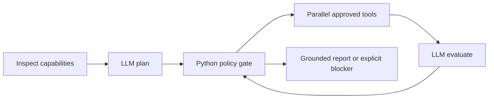

# Architecture and A0 integration

Latest implementation: computed routing passes through a metered
`RouteAgent` when enabled, with native crops, conservative adaptive regional
grids, up to 16 ordered waypoints, persistent chat revisions and grounded
rationale. See [regional verification](regional-verification.md), the
[agent/chat guide](a0-agent-chat.md) and [Docker runtime](docker.md).
The first real API attempt returned HTTP 429; the integrated flow has been
verified with mocked models and a real browser/DEM, not a successful live model.

The [current TODO](TODO.md) records pending scientific, provider, deployment and
display acceptance work. Docker packaging serves production UI/API together,
accepts an external runtime env-file mount, and separates read-only inputs from
persistent application state. Actual engine build/restart acceptance is pending.

`planning/grid.py` reads native derivatives and conservatively aggregates bounded
tiles. `planning/solver.py` solves ordered legs under shared budgets.
`PlanningService` can retry a disconnected crop against the full source without
another model call. `planning/validation.py` independently checks emitted segments
and re-reads native cells for aggregated routes. The store validates artifact
integrity and source/grid geometry on retrieval.

The browser renders NASA Mars Trek imagery and sends relative `/api/v1` requests to FastAPI. Validation follows the [API protocol](A_STELLAR_FRONTEND_BACKEND_PROTOCOL_PLAN.md) and [A0 addendum](a0-api-contract.md). Explicit computed mode uses `PlanningService` for DEM ingestion, bounded A*, independent segment validation and durable storage. Default mock mode retains `MissionCoordinator` and null metrics.

`WorkerRegistry` allowlists A1/A2/A3/A4/A6. `AgentDispatcher` invokes async workers with typed outputs, isolated failures and cooperative timeouts. Arrays and scientific products stay in `data/`; responses carry references and provenance. Blocking scientific processing should run outside the request event loop: async timeouts cannot forcibly stop blocking code.

| Component | Current state |
| --- | --- |
| A0 | Mission Orchestration and Route Planning Coordinator: ordinary Python terrain pipeline and persisted results; separate optional LangGraph experiment |
| A1/A2 | Opt-in shared async adapters around Sam's standalone scripts; outputs stay prototype scenarios pending scientific validation |
| A3 | Documented dose-equivalent scenarios and separate raw RAD inspection |
| A4 | Sampling POIs and ambiguity-aware geology associations; priorities remain unranked |
| A6 | Rover history, metric proximity and bounded verified Navcam references |
| Public API | Default mock mode; configured computed POST and persisted GET; no automatic downloads or optional-worker activation |

## Data and coordinates

Repository-managed artifacts belong under [data/](datasets.md), and documentation under `docs/`. The approved A0 milestone reads the user's large raw inputs from an explicitly configured external dataset directory. Existing caches remain in place because provenance may contain absolute paths. Current A1/A2 defaults resolve from the repository location rather than the working directory.

The wire convention is `MARS_2000_PLANETOCENTRIC_EAST_360_V1`: finite east longitude `[0,360)` and planetocentric latitude `[-90,90]`. NASA's WMTS label `EPSG:104905` is preserved as a native angular Mars projection, not Earth EPSG:4326. Its angular tile grid derives from advertised dimensions, not Earth scale denominators. Source-evidence checks do not validate WMTS ↔ wire ↔ DEM alignment; computed map display remains disabled.

## Implementation stages

| Stage | Status and gate |
| --- | --- |
| 1. Foundation | API/worker contracts, deterministic A0 and honest mocks implemented. Sam's shared-schema review and coordinate agreement remain required. |
| 2. Evidence | A4/A6 source-backed pipelines implemented; coverage remains partial. |
| 3. Planning | Native metric DEM grid, masks, mode-specific costs, bounded A* and independent validation implemented; real CTX/API/restart checks pass. Map registration remains pending. |
| 4. Constraints | A3 scenarios implemented. A2 integration, mission-approved policy and science itinerary remain pending. |
| 5. A0/release | Agentic evidence loop and deterministic routing tested separately. Live models are deferred; computed browser display remains pending. |

## Deterministic terrain pipeline

The host configures `A_STELLAR_ROUTING_MODE`, `A_STELLAR_PLANNING_PROFILE`,
`A_STELLAR_DATASET_DIR` and optionally `A_STELLAR_ROUTE_STORE`. Ingestion reads
a bounded native spherical Mars equirectangular DEM window with a derivative
halo. Separate coverage, unknown and blocked masks prevent NoData traversal.
Unknown cells are impassable. Eight-connected A* uses physical projected edge
lengths and disallows blocked diagonal corners. `safest` adds the documented
nonnegative slope penalty; neither mode certifies safety.

Raster/planning/persistence work runs outside the HTTP event loop. Search has
explicit node/time limits; grid allocation and segment validation are bounded.
Cancelling an HTTP request does not forcibly terminate a worker thread. Each
run has isolated immutable artifacts. The validator checks closed cell-box
intersections for every segment, exact endpoint connectors, source version and
emitted wire geometry. An atomic directory rename publishes a complete run;
retrieval verifies schemas, identity, completion and artifact hashes.

The frontend reuses its existing transport, selection/cancellation hook and
overlay. Computed distance/metadata are inspectable; computed map geometry is
withheld by the coordinate guard. Read the [verification report](a0-verification-report.md)
for the distinction between projected-coordinate controls and map registration.

## Agentic A0

`app.coordinator.agent.MissionAgent` runs this graph separately from the deterministic public terrain pipeline and preserved mock `MissionCoordinator`. Plans are strict `Proposal` objects, not generated code. The host fixes mission scope, numeric parameters, dataset bindings and filesystem paths. The model selects only advertised tool names and cites known evidence IDs; it cannot alter inputs, waive constraints or supply executable arguments.

The planner and evaluator use the same logical model with different phases. Independent workers run through the existing dispatcher. Policy rejects invented tools, extra fields, duplicate calls, unknown citations, premature completion and validation without a route candidate. It substitutes a deterministic plan on model/schema/policy failure. Defaults: eight total tool calls including capability inspection, two replans, 30-second model timeout, 10-second worker timeout and 120-second graph deadline. Profile loading occurs before that deadline. Recursion and decision counts are bounded separately.

The runtime [SKILL.md](../backend/app/coordinator/skills/mission-coordinator/SKILL.md) supplies the agent's instructions and is included in package data. Its normalized text hash is recorded with provider/model, limits, source-input hashes, dataset version, proposals and execution events. Model context contains scalar fact summaries and evidence IDs, not rasters, full POI lists, raw worker prose, artifact paths or credentials. Raw worker results are local referenced artifacts; LangSmith tracing is disabled for these runs.

Only Python builds final findings from typed tool facts. Unknown values stay null; source-less/mock outputs cannot become measurements. Scenario budget passes retain scenario scope. `plan_route` currently reports unmet prerequisites; `validate_route` stays disabled. No route, scientific value or safety claim is invented to satisfy a mission.

The live provider uses an explicitly selected model and the [OpenAI Responses function-call interface](https://developers.openai.com/api/reference/resources/responses/methods/create), with a forced strict proposal function and local revalidation. Graph nodes/conditional edges follow the [LangGraph Graph API](https://docs.langchain.com/oss/python/langgraph/graph-api). Scripted mode exercises the same execution graph without an LLM or network call; it is not advertised as a live model test.

## Historical next-step list and remaining gates

The user-approved next milestone is defined in the
[deterministic A0 plan](a0-implementation-plan.md),
[API addendum](a0-api-contract.md) and [verification guide](a0-verification.md).
It prioritizes real A*, persistent route metadata and frontend retrieval using
ordinary Python orchestration. The existing LangGraph graph stays optional;
live-model smoke testing is deferred beyond this milestone. The historical
next-step list below describes the earlier integration gates, not a requirement
to add a live LLM before deterministic routing.

1. Configure and validate A1/A2 prototype sources. Their adapters now implement the shared worker interface with provenance/context checks, lazy raster imports and offloaded blocking work.
2. Agree with Sam on the canonical metric grid, masks and source/wire/raster points. Prototype artifacts do not yet provide this validated planning handoff; A1's shared grid/mask fields stay null and A2 constraints stay unknown.
3. Connect fusion, deterministic planning and route validation. Keep the public endpoint mocked until these gates pass.
4. Register explicitly configured A3/A4/A6 as optional context. Observations and scenario budget passes never automatically reduce terrain risk.
5. Smoke-test the live provider with an explicitly configured model, then activate planner tools only after deterministic route validation. Agentic evidence analysis is available now; no public API extension is introduced.

Full ownership and acceptance criteria remain in the [team master plan](A_STELLAR_JEZERO_TEAM_BACKEND_MASTER_PLAN.md).
